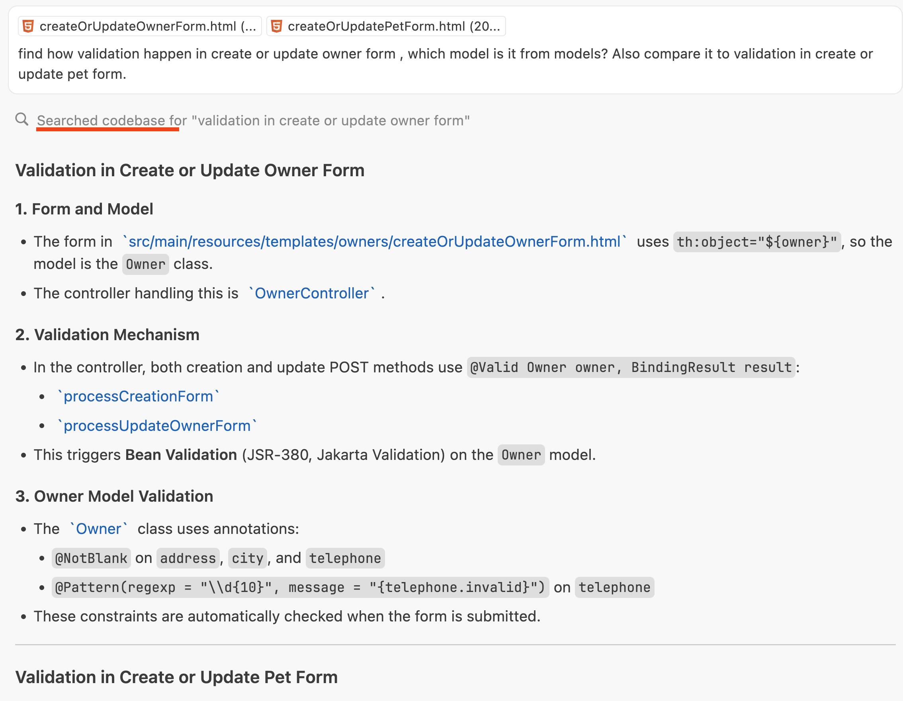
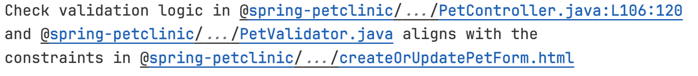
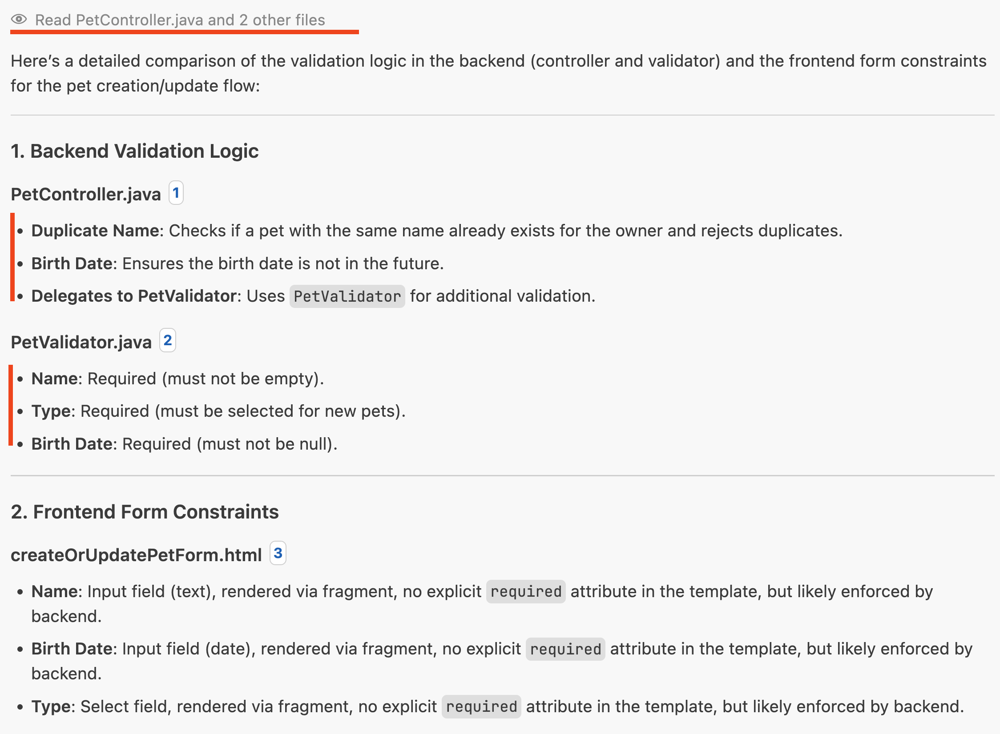

# InContext

<p align="center">
  
</p>

**Prompt the right way. Structure your AI prompts naturally, with inline, pinpoint-accurate code references — delivering better LLM outputs, preserving your visual context, and enabling logical, easy-to-read prompts.**

---

## 🚀 Features

- **Inline, Clickable Code References:** Instantly copy and share references to files, folders, or code ranges in your workspace, using the `@project/path/to/file:L10:20` format.
- **Beautiful Inline Feedback:** When you copy a reference, a large, styled inline message (`Reference added to clipboard!`) appears next to your selection or cursor, with a border and padding for clarity.
- **Explorer & Editor Integration:** Copy references from the editor or the file/folder context menu in the Explorer.
- **Hover Previews:** Hover over a reference to preview code or see folder contents.
- **Clickable in Markdown Preview:** References in your markdown become links in VS Code's Markdown preview — no changes to the markdown needed.
- **Clickable in the terminal and in AI replies:** References printed in VS Code's terminal open with a click, and GitHub Copilot and Claude Code can be told to cite code as references that open the same way.
- **Clickable in desktop chat apps:** In the Claude, ChatGPT/Codex and GitHub Copilot apps, AI replies can cite code as links that open in VS Code with the lines selected.
- **One instruction for every AI tool:** A command installs the instruction that makes Claude Code, GitHub Copilot and Codex cite code this way.
- **Keyboard Shortcuts:** Use <kbd>Cmd</kbd>+<kbd>'</kbd> to copy references quickly.
- **No intrusive popups:** All feedback is inline and non-blocking.

---

## 🛠️ Usage

### Copy a Code Reference

- **From the Editor:**
  - Select code, right-click, and choose **Copy Code Reference to Clipboard** (or press <kbd>Cmd</kbd>+<kbd>'</kbd>).
  - If no selection, copies a reference to the current file.
  - An inline message will appear: <span style="color:#4caf50; font-weight:bold; border:1px solid #78b37aff; padding:0.15em 0.7em; font-size:1.2em;">Reference added to clipboard!</span>

- **From the Explorer:**
  - Right-click a file or folder and choose **Copy File Reference** or **Copy Directory Reference**.

### Paste the Reference

- Paste anywhere: in markdown, code comments, prompts, or chat tools. The reference is clickable and will open the file/lines in VS Code.

### Hover for Preview

- Hover over a reference to preview code or see folder contents inline.

### Markdown Preview

- References in markdown files are clickable in the Markdown preview (<kbd>Cmd</kbd>+<kbd>Shift</kbd>+<kbd>V</kbd>), whether written bare (`@project/src/file.ts:L10:20`) or in inline code. Clicking opens the file in the project's workspace folder with the lines selected, in a split beside the preview so the preview stays visible; later clicks reuse that split. <kbd>Cmd</kbd>+click (<kbd>Ctrl</kbd>+click on Windows/Linux) opens the reference in another new split instead.
- Both line styles work: `:L10:20` and the markdown/GitHub style `#L10-L20`.
- Hover a reference in the preview to peek at the referenced lines (or a folder's contents), like the hover in the editor.
- Give a reference its own label with a markdown link: `[the parser](@project/src/file.ts#L10-L20)`.
- Plain relative markdown links get line ranges too: `[the parser](../src/file.ts#L10-L20)`.
- The first click may ask *Allow 'Code Reference Extension' extension to open this URI?* — tick **Do not ask me again**.

### Terminal

- References printed in VS Code's integrated terminal — by GitHub Copilot CLI, Claude Code, scripts or anything else — are clickable. <kbd>Cmd</kbd>+click (<kbd>Ctrl</kbd>+click on Windows/Linux) opens the file with the lines selected, in the editor.

### Citing code from AI assistants

- Links of the form `vscode://managea.incontext/@project/src/file.ts:L10:20` (or `#L10-L20`) open a reference from anywhere VS Code opens links, including GitHub Copilot Chat replies and AI tools in the terminal. This short form needs incontext 1.2.0 or later.
- The Claude desktop app, the ChatGPT/Codex app and the GitHub Copilot app don't open `vscode://` links, so the instruction below has AI tools link to incontext's link server instead, unless they know their reply is shown inside VS Code or in a terminal (see [Desktop chat apps](#desktop-chat-apps-claude-chatgptcodex-and-github-copilot)).
- The instruction below tells an AI tool which link to write in a reply, and to write the plain reference in the files it edits. One instruction serves every tool, and [one command](#use-one-instruction-in-every-ai-tool) installs it in all of them:

  <!-- ai-instructions:start (generated from media/ai-instructions.md by npm run sync-readme) -->
  ```markdown
  ## Code references

  When you cite code from a workspace file in a reply, write it as a Markdown link whose label is the incontext reference itself (such as @incontext/src/extension.ts:L36:68) and whose target is an incontext link, so a click opens it in VS Code with the lines selected. Put other words, such as the symbol's name, outside the link. For workspace code, this takes precedence over other instructions about how to link to files.

  If your reply is shown in a desktop app, such as the Claude desktop app, the ChatGPT/Codex app or the GitHub Copilot app, or you aren't sure where it is shown, use this target. It works wherever VS Code is running:

  [@<folder>/<path>:L<start>:<end>](http://localhost:46266/open#@<folder>/<path>:L<start>:<end>)

  Only when you know your reply is shown inside VS Code or in a terminal (such as Claude Code, GitHub Copilot CLI or Codex CLI running in a terminal), use this target instead, which opens VS Code directly:

  [@<folder>/<path>:L<start>:<end>](vscode://managea.incontext/@<folder>/<path>:L<start>:<end>)

  In a file you create or edit (Markdown, code comments), refer to code and to other workspace files with the reference itself as plain text, never inside a Markdown link, such as @incontext/src/extension.ts:L36:68. The incontext extension makes it clickable in VS Code. When an edit moves the lines a reference points to, update its numbers.

  - <folder> is the name of the VS Code workspace folder that contains the file (usually the repository's root folder), and <path> is the file's path relative to it, with forward slashes. Percent-encode spaces as %20.
  - Use :L<line> for a single line, leave out the line part to refer to a whole file, and end the path with / to refer to a folder.
  - Don't put a reference or link in backticks or a code block, and only cite lines you have read.

  Example in a reply: openReference is at [@incontext/src/extension.ts:L36:68](http://localhost:46266/open#@incontext/src/extension.ts:L36:68), or inside VS Code or a terminal [@incontext/src/extension.ts:L36:68](vscode://managea.incontext/@incontext/src/extension.ts:L36:68).
  ```
  <!-- ai-instructions:end -->

### Use one instruction in every AI tool

Run **InContext: Set Up AI Assistant Instructions** from the Command Palette. It shows the files below, lets you pick the tools, and writes the instruction with your link server's port. Nothing else in those folders changes.

| Tool | What the command writes | Where the tool reads your instructions |
| --- | --- | --- |
| Claude Code (CLI, IDE and Claude desktop app) | `~/.claude/rules/incontext-references.md`, a file of its own | `~/.claude/CLAUDE.md` and `~/.claude/rules/*.md` ([docs](https://code.claude.com/docs/en/memory)) |
| GitHub Copilot (VS Code, Copilot CLI and the GitHub Copilot app) | `~/.copilot/instructions/incontext-references.instructions.md`, a file of its own with `applyTo: "**"` | `~/.copilot/copilot-instructions.md` and `~/.copilot/instructions/**/*.instructions.md` ([CLI docs](https://docs.github.com/en/copilot/how-tos/copilot-cli/customize-copilot/add-custom-instructions), [VS Code docs](https://code.visualstudio.com/docs/copilot/customization/custom-instructions)) |
| Codex (CLI and ChatGPT/Codex app) | a marked block in `~/.codex/AGENTS.md` (in `$CODEX_HOME` when that is set, and in `AGENTS.override.md` when you have one); the rest of the file stays as it is | that one file, which can't include others ([docs](https://learn.chatgpt.com/docs/agent-configuration/agents-md.md)) |

- Run the command again after updating incontext to update the instruction. When you change `incontext.linkServer.port`, incontext offers to update what it wrote. When a symlink leads one of these files elsewhere, the command says where and asks first.
- **InContext: Remove AI Assistant Instructions** deletes incontext's two files and its block in `AGENTS.md`.
- To do it by hand instead, keep the instruction in one file of your own and symlink it into `~/.claude/rules/` and `~/.copilot/instructions/` (start the file with `applyTo: "**"` front matter, which Copilot in VS Code needs), and paste it into Codex's `AGENTS.md`. Don't symlink to `media/ai-instructions.md` in the installed extension's folder: that folder changes with every update, and its copy has placeholders where your port goes.
- For a single repository, put the instruction in its `AGENTS.md`, which all of these tools read (Claude Code only when the repository has no `CLAUDE.md`).

### Desktop chat apps: Claude, ChatGPT/Codex and GitHub Copilot

- These apps don't open `vscode://` links, but they do open `http://localhost` links. So the extension runs a small link server on your machine, and a link such as `http://localhost:46266/open#@incontext/src/extension.ts:L392:394` opens that reference in VS Code's editor with the lines selected (or a whole file, or reveals a folder in the Explorer). VS Code doesn't come to the front, so you stay in the app.
- Good to know:
  - Tested on macOS, with the Claude, ChatGPT/Codex and GitHub Copilot apps. Windows and Linux should work too, but haven't been tried yet.
  - VS Code must be running with the reference's folder open. Without VS Code, the click shows a page saying it can't connect.
  - In the Claude app, use a plain click. <kbd>Cmd</kbd>+click opens the link in your default browser instead, which comes to the front; its tab closes itself once VS Code has the reference.
  - In the ChatGPT/Codex app, the link opens in the app's browser, and that page closes itself once VS Code has the reference.
  - In the GitHub Copilot app, the link opens in the app's own browser.
  - Links open files inside your workspace folders only. The server listens on 127.0.0.1 only and never sends file contents back. Any web page could link to it too, but the most such a link can do is open a file of your workspace in VS Code.
  - With several VS Code windows open, the first window to start answers the links and passes each one on to the window that has the reference's folder (the most recently focused one if several have it). When that window closes, another one takes over within a few seconds. The **InContext** channel in the Output panel shows what the link server is doing.
  - The port is 46266 unless you change the `incontext.linkServer.port` setting; incontext then offers to update the AI assistant instructions it wrote. Turn the server off with `incontext.linkServer.enabled`.
  - Remote windows (SSH, containers, WSL) don't run the link server.

---

## 📦 Installation

1. Download the latest `.vsix` file from your build (e.g., `incontext-1.0.1.vsix`).
2. In VS Code, open the Command Palette (<kbd>Cmd</kbd>+<kbd>Shift</kbd>+<kbd>P</kbd>), type `Extensions: Install from VSIX...`, and select your `.vsix` file.
3. Reload VS Code if prompted.

---

## 📝 Changelog

- **1.3.1**
  - The AI assistant instruction covers files too: in Markdown files and code comments, AI tools write the plain reference, which incontext makes clickable, instead of a Markdown link, and keep its line numbers up to date. Run **InContext: Set Up AI Assistant Instructions** again to update what it wrote

- **1.3.0**
  - Links to `http://localhost:46266/open#@project/src/file.ts:L10:20` open references in VS Code from the Claude desktop app, the ChatGPT/Codex app and the GitHub Copilot app (tested on macOS). Settings: `incontext.linkServer.enabled` and `incontext.linkServer.port`
  - **InContext: Set Up AI Assistant Instructions** writes one citation instruction into Claude Code, GitHub Copilot and Codex, with the link server's port, and **InContext: Remove AI Assistant Instructions** takes it out again. The README shows the same instruction
  - References from AI replies (desktop apps, the terminal, `vscode://` links such as Copilot Chat's) open in the editor like any other file, instead of in a split; Markdown preview links still open beside the preview
  - Security: a `vscode://managea.incontext` link that the Markdown preview didn't render (such as one on a web page) only opens files inside your workspace folders, `..` and symlinks included, and may only name a document that is open to resolve relative paths from. Links in the Markdown preview still open files outside the workspace, such as a sibling repository

- **1.2.0**
  - References printed in VS Code's integrated terminal (Copilot CLI, Claude Code, scripts) are clickable
  - Short links, `vscode://managea.incontext/@project/src/file.ts:L10:20`, open references from GitHub Copilot Chat, Copilot CLI and anywhere else VS Code opens links; the README has a Copilot instruction for citing code this way
  - In the Markdown preview, references right after `:` and other punctuation are links too

- **1.1.0**
  - References are clickable in the Markdown preview — bare (`@project/src/file.ts:L10:20`), in inline code, or as `[label](@project/src/file.ts#L10-L20)` — with no changes to your markdown
  - Hover a reference in the Markdown preview to peek at the referenced code or folder contents
  - References clicked in the preview open in a split beside it, reused by later clicks; <kbd>Cmd</kbd>+click opens another split
  - Line ranges work in both styles, `:L10:20` and `#L10-L20`, and plain relative markdown links like `[label](../src/file.ts#L10-L20)` get line ranges too
  - Fixed references inside markdown links picking up the closing `)`

- **1.0.1**
  - Added large, styled inline decoration for copy feedback (with border and padding)
  - Improved keyboard shortcuts and context menu integration
  - Enhanced hover previews for code and folders
  - Bug fixes and polish

---

## 🔑 Why This Matters

When crafting AI prompts, structure is everything. Traditional prompts that dump all context at the top, or attach files separately, confuse both humans and AI.

InContext lets you write prompts the way you think and communicate:

* You say "Look at this..."
* The relevant code reference follows naturally, inline.
* LLMs understand that "this" points precisely to the lines or file you reference—no ambiguity.
* This results in:
  * More accurate, reliable AI outputs.
  * Pinpoint control over what the LLM focuses on.
  * Logical, English-like prompts that flow naturally.


**This isn't just beautiful formatting—it's the correct, structured way to write prompts that maximize AI performance.**

By embedding references inline, in logical order, you:

* Give the LLM precise, localized context exactly where it's needed.
* Avoid forcing the AI to "guess" from a giant, scattered context block.
* Write better prompts, get better results.

---

**Why the New Way Wins:**

The new InContext prompting style gives you—and your AI—spatial awareness: you write prompts naturally, referencing code inline, exactly where it matters. This keeps you (the developer) in flow, lets you express your intent in logical, English-like order, and ensures the LLM receives precise, localized context. By crafting prompts with **surgical precision**, you make them not only easier for yourself to read and reason about, but also enable the LLM to interpret your intent and context with the same level of accuracy. The result? Dramatically higher quality, more accurate outputs. You get answers that are not only easier to verify, but also more relevant—because both you and the AI are always looking at the right code, at the right time.


## 🖼️ Example

Below is a real-world example showing the difference between the old and new ways of providing context to an LLM, using screenshots from the Spring Petclinic project:

### Old way: LLM-Driven Search & Synthesis



- The LLM receives a high-level question and performs a semantic search across the codebase.
- It guesses which files are relevant and synthesizes an answer based on search results.
- The answer is often general, referencing files and classes, but not always pointing to exact lines.
- The process can be slower and less precise, especially if the search misses a key file or context.

### New Way: Explicit Context Injection
#### Prompt with InContext 🧘🏼‍♂️
  

#### Result 👌
  

- The user (or system) directly attaches the relevant files and line ranges to the LLM's context.
- The LLM immediately has access to the exact code needed for the answer.
- The answer can reference specific files and line numbers with precision.
- The process is faster and more reliable, as it avoids unnecessary searching.

#### **Key Benefits of the New Way**
- **Precision:** Answers reference exact files and line numbers, making navigation easy.
- **Efficiency:** No time wasted on searching or sifting through irrelevant results.
- **Reliability:** Reduces the risk of missing important context or making incorrect assumptions.
- **User Experience:** Users get actionable, context-rich answers that are easy to verify and follow up on.

> **Best Practice:**
> Whenever possible, provide the LLM with the exact files and line ranges relevant to the question. This enables the LLM to deliver answers that are both accurate and immediately useful, especially for code navigation and review tasks.

---

## ✨ Why the New Way is Better

- **Pinpoint Accuracy & Surgical Precision:** Every claim is backed by a direct, clickable reference to the codebase, often with line numbers. Prompts are crafted with surgical precision, benefiting both human readers and the LLM.
- **Instant Verification:** You can check any statement by clicking the link—no more manual searching.
- **Always Up-to-Date:** Answers are grounded in the current code, not memory or guesswork.
- **Superior Collaboration:** Share prompts and answers with teammates; everyone can instantly navigate to the relevant code.
- **Cleaner Prompts:** Inline references keep your visual context clean and logical, making prompts easier to write, read, and reuse.

**InContext is the right way to write prompts—maximizing AI performance, developer confidence, and team productivity.**

---

### 💡 Inspired by WindSurf

The inspiration for this type of prompting came from **WindSurf IDE**, which introduced the idea of connecting code context to prompts.


### 🌐 Flexible, Universal Usage

* You can embed these references **anywhere** — in `.txt` files, `.md` files, code comments, documentation, AI prompts, or chat tools.
* References are fully **clickable**, regardless of file type.
* Great for connecting different parts of your codebase with in-code, bidirectional links.
* Ideal for enhancing documentation, linking to other files with precise, interactive references.
* Share prompts with your team, preserving full click-through context for consistent collaboration.

### 💡 This is the right way to write prompts.

Stop forcing rigid "context blocks" and losing clarity. Start writing naturally—with precise, inline references that:

* Preserve your visual context.
* Provide AI with correct, ordered, logical knowledge.
* Give your prompts pinpoint, localized context.
* Improve AI output quality.
* Keep your workspace clean, navigable, and intuitive.
* Create reusable, shareable, context-rich prompts for your team.

