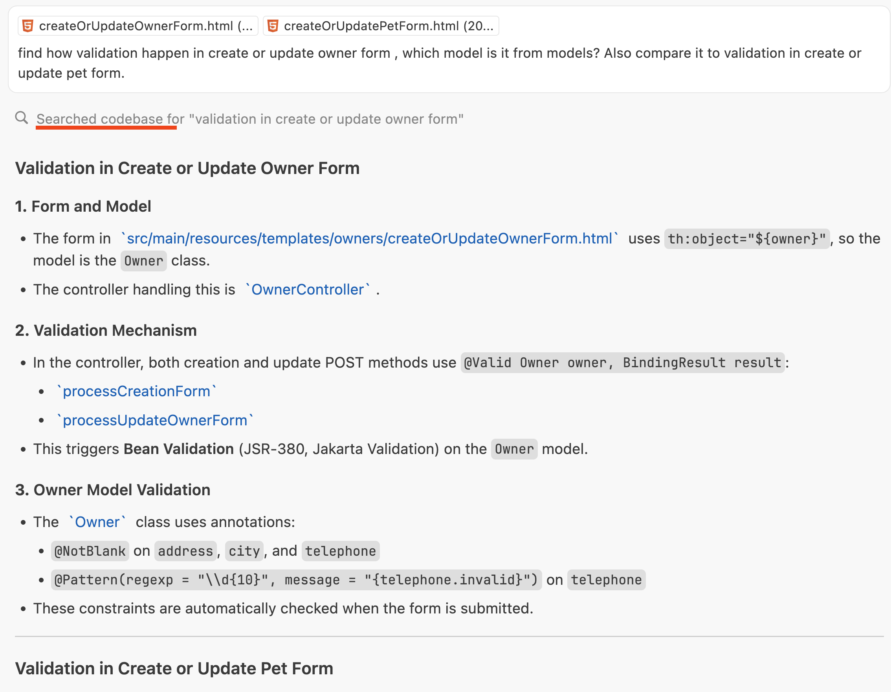
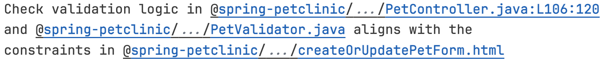
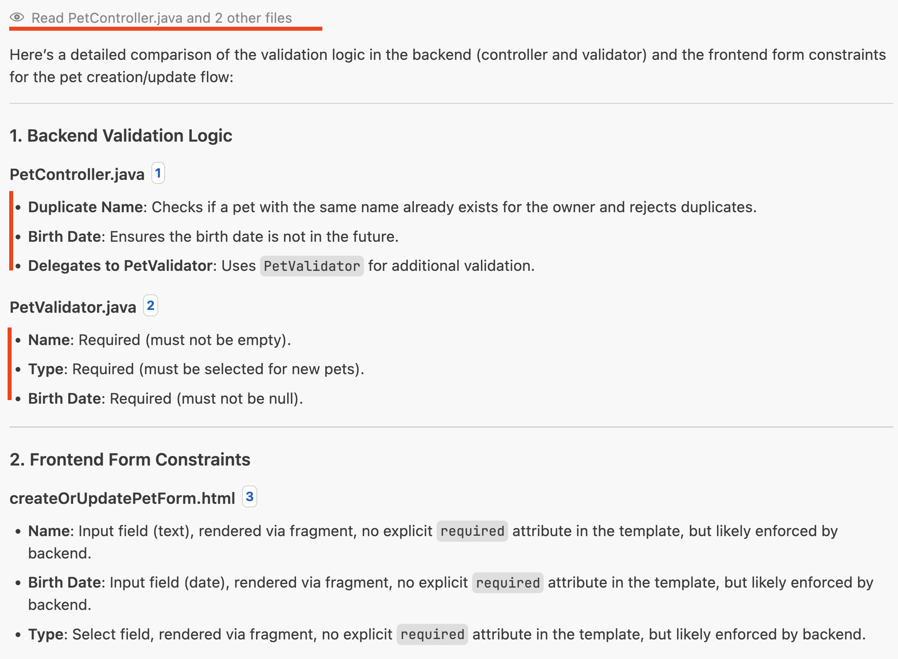
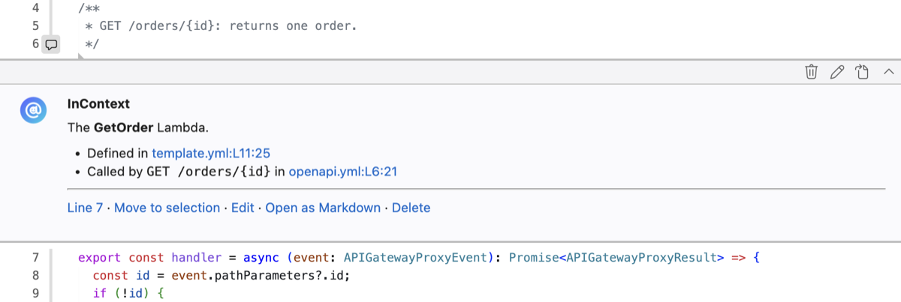
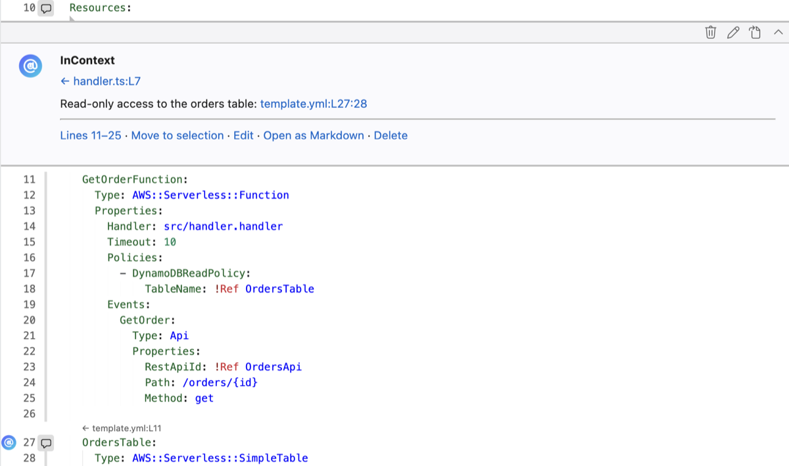
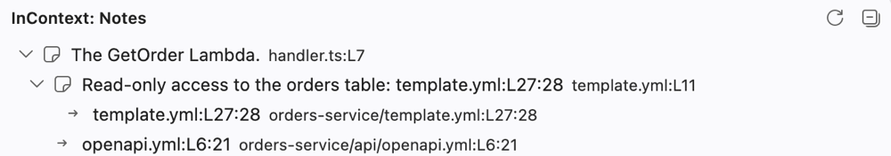
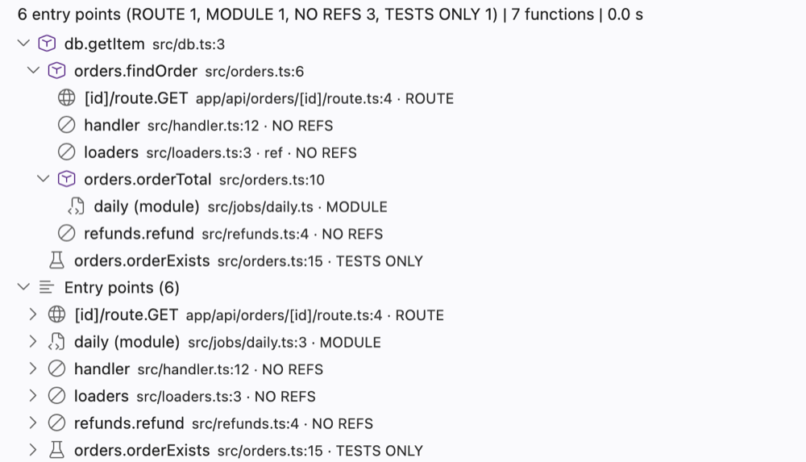

<p align="center">
  
</p>

<h1 align="center">InContext</h1>

<p align="center">
  <b>Find your way around code that agents write.</b><br>
  Pinpoint references and notes on code, shared by you and your AI agents, that open anywhere with a click.
</p>

<p align="center">
  <a href="https://marketplace.visualstudio.com/items?itemName=managea.incontext"></a>
  <a href="https://open-vsx.org/extension/managea/incontext"></a>
  <a href="LICENSE"></a>
</p>

<p align="center">
  <a href="#quick-start">Quick start</a> ·
  <a href="#code-references">References</a> ·
  <a href="#open-references-anywhere">Open anywhere</a> ·
  <a href="#notes-on-code">Notes</a> ·
  <a href="#ai-assistants">AI assistants</a> ·
  <a href="#caller-tree">Caller Tree</a> ·
  <a href="#commands-shortcuts-and-settings">Reference</a>
</p>

---

InContext began as a way to put pinpoint code references into AI prompts. Now that agents write much of the code, it has grown into a way for you and your agents to understand that code and move around it together, speaking the same language: a reference such as `@incontext/src/extension.ts:L36:68`, which names exact lines and opens them in VS Code wherever it is clicked.

- **You point the agent at the code.** Put references inline in a prompt, in the order you'd explain it, instead of leaving the agent to search.
- **The agent points back.** Its replies cite code as references, so every claim about the code is one click from the lines it rests on, in VS Code, the terminal, or the Claude, ChatGPT/Codex and GitHub Copilot apps.
- **Either of you maps the flow.** Notes on code link each step of a flow to the next, and back-links lead the other way, so code an agent wrote can be read, followed and checked step by step, by you or by the next agent.
- **You see what a change touches.** The Caller Tree shows everything that reaches a function, up to its entry points.

| Feature | What it does |
| --- | --- |
| **[Code references](#code-references)** | Copy a reference to a selection, file or folder with <kbd>Cmd</kbd>+<kbd>'</kbd>, paste it into a prompt or a doc, hover it to preview the code. |
| **[Open anywhere](#open-references-anywhere)** | References open with the lines selected from the Markdown preview and Mermaid diagrams, the terminal, AI replies, the Claude, ChatGPT/Codex and GitHub Copilot apps, Excalidraw drawings and Obsidian. |
| **[Notes on code](#notes-on-code)** | Markdown notes on lines, written by you or your agent and kept outside your repositories. The places a note points to link back, so a flow reads as a chain. |
| **[AI assistants](#ai-assistants)** | One command sets up Claude Code, GitHub Copilot and Codex to cite code as clickable references, and to write notes when you ask. |
| **[Caller Tree](#caller-tree)** | Everything that reaches the function at the cursor, up to its entry points, each row labelled `File.function`. |

## Quick start

1. Install **InContext** from the [VS Code Marketplace](https://marketplace.visualstudio.com/items?itemName=managea.incontext), or from [Open VSX](https://open-vsx.org/extension/managea/incontext) in Cursor and other VS Code forks.
2. Select some lines and press <kbd>Cmd</kbd>+<kbd>'</kbd>. A reference such as `@incontext/src/extension.ts:L36:68` is on your clipboard.
3. Paste it into a prompt, a Markdown file or a code comment. In VS Code it is a link: click it to open the lines.
4. Optionally, run **InContext: Set Up AI Assistant Instructions** from the Command Palette, so your AI tools reply with references you can click. See [AI assistants](#ai-assistants).

## Why references and notes

Agents write code faster than anyone can read it. What keeps you in charge is being able to say exactly which code you mean, check exactly which code the agent means, and keep what either of you worked out where the next person, or the next agent, will find it.

- **Precise prompts.** A prompt reads best the way you'd explain the code to a colleague: *"look at this"*, followed by exactly the lines you mean. Inline references give the agent precise, ordered context where it is needed, instead of a pile of files to search through.
- **Answers you can check.** When the agent cites code as references, you check each claim with a click rather than hunting for the code yourself.
- **Understanding that lasts.** A chat ends; notes on code stay beside the lines they explain. An agent can map a flow with notes as it codes, and you, a teammate or the next agent can follow it later.

<details>
<summary><b>An example:</b> the same question, without and with references</summary>

**Without references, the agent searches.** It guesses which files matter and answers in general terms, naming files and classes but rarely exact lines:



**With InContext, the agent is told where to look.** The prompt points at the exact lines:



and the answer cites specific files and lines, each one a click away:



</details>

The idea of connecting code context to prompts this way was inspired by Windsurf.

## Code references

### The reference format

A reference starts with `@`, then the name of the VS Code workspace folder (usually the repository's root folder), then the path inside it:

| Reference | Points to |
| --- | --- |
| `@incontext/src/extension.ts` | a file |
| `@incontext/src/extension.ts:L36` | one line |
| `@incontext/src/extension.ts:L36:68` | lines 36 to 68 |
| `@incontext/src/extension.ts#L36-L68` | the same lines, in the Markdown and GitHub style |
| `@incontext/src/` | a folder |

Where a URL is needed, wrap the reference in a link:

| Link | Use it in |
| --- | --- |
| `vscode://managea.incontext/@incontext/src/extension.ts:L36:68` | VS Code itself: Copilot Chat replies, AI tools in the terminal, Excalidraw drawings |
| `http://localhost:46266/open#@incontext/src/extension.ts:L36:68` | apps and pages outside VS Code: the [desktop chat apps](#desktop-chat-apps-claude-chatgptcodex-and-github-copilot), browsers, Obsidian's Mermaid diagrams |

In Markdown, give a reference its own label with a link: `[the parser](@project/src/file.ts#L10-L20)`.

### Copy a reference

- **In the editor:** select code and press <kbd>Cmd</kbd>+<kbd>'</kbd>, or right-click and choose **Copy Code Reference to Clipboard**. With no selection, it copies a reference to the file. A short confirmation shows beside the cursor, with no popup to dismiss.
- **In the Explorer:** select a file or folder and press <kbd>Cmd</kbd>+<kbd>'</kbd>, or right-click and choose **Copy File Reference to Clipboard** or **Copy Directory Reference to Clipboard**.
- **For a drawing:** **Copy Reference as Link (for Drawings)** (<kbd>Cmd</kbd>+<kbd>Alt</kbd>+<kbd>'</kbd>) copies the `vscode://` link instead. See [Drawings](#drawings-excalidraw).

Paste it anywhere: Markdown, code comments, `.txt` files, prompts, chat tools. In VS Code the reference is clickable whatever the file type, and hovering it previews the lines, or a folder's contents.

## Open references anywhere

| Where | What a click does |
| --- | --- |
| [Markdown preview](#markdown-preview) | Opens the lines in a split beside the preview |
| [Mermaid diagrams](#markdown-preview) in the preview | Same, from a box's `click` line |
| [Terminal](#terminal) | <kbd>Cmd</kbd>+click opens the lines in the editor |
| [AI replies in VS Code](#ai-replies-in-vs-code-and-the-terminal) | Opens the lines in the editor |
| [Claude, ChatGPT/Codex and GitHub Copilot apps](#desktop-chat-apps-claude-chatgptcodex-and-github-copilot) | Opens the lines in VS Code, through a link server on your machine |
| [Excalidraw drawings](#drawings-excalidraw) | Opens the lines beside the drawing |
| [Obsidian](#obsidian) | Opens the lines in VS Code, from notes and Mermaid diagrams |

### Markdown preview

- References in Markdown files are clickable in the Markdown preview (<kbd>Cmd</kbd>+<kbd>Shift</kbd>+<kbd>V</kbd>), written bare (`@project/src/file.ts:L10:20`) or in inline code, with no changes to your Markdown. Both line styles work, `:L10:20` and `#L10-L20`.
- A click opens the file in the project's workspace folder with the lines selected, in a split beside the preview so the preview stays visible; later clicks reuse that split. <kbd>Cmd</kbd>+click (<kbd>Ctrl</kbd>+click on Windows and Linux) opens another new split instead.
- Hover a reference to peek at the lines, or at a folder's contents, as in the editor.
- Plain relative Markdown links get line ranges too: `[the parser](../src/file.ts#L10-L20)`.
- **Mermaid diagrams** (drawn by a Mermaid preview extension): a box whose `click` line links to a reference opens it the same way, such as `click A "@project/src/file.ts:L10:20"` or `click A "http://localhost:46266/open#@project/src/file.ts:L10:20"`. A sequence diagram's `link` lines work too, with the `#` written as `#35;`. References in a diagram's labels stay text.
- The first click may ask *Allow 'Code Reference Extension' extension to open this URI?* Tick **Do not ask me again**.

### Terminal

References printed in VS Code's integrated terminal, by GitHub Copilot CLI, Claude Code, scripts or anything else, are clickable. <kbd>Cmd</kbd>+click (<kbd>Ctrl</kbd>+click on Windows and Linux) opens the file in the editor with the lines selected.

### AI replies in VS Code and the terminal

`vscode://managea.incontext/@project/src/file.ts:L10:20` links (or `#L10-L20`) open a reference from anywhere VS Code opens links, including GitHub Copilot Chat replies and AI tools in the terminal. The [AI assistant instruction](#ai-assistants) has your AI tools write these links when their reply is shown in VS Code or a terminal.

### Desktop chat apps: Claude, ChatGPT/Codex and GitHub Copilot

These apps don't open `vscode://` links, but they do open `http://localhost` links. So InContext runs a small link server on your machine, and a link such as `http://localhost:46266/open#@incontext/src/extension.ts:L392:394` opens that reference in VS Code's editor with the lines selected (or a whole file, or reveals a folder in the Explorer). The [AI assistant instruction](#ai-assistants) has AI tools write these links when they aren't sure where their reply is shown.

- **Claude app:** use a plain click. In its Browser pane VS Code stays behind, so you stay in the app. <kbd>Cmd</kbd>+click opens the link in your default browser instead.
- **ChatGPT/Codex app:** the link opens in the app's browser, which closes the page once VS Code has the reference, and VS Code comes to the front.
- **GitHub Copilot app:** the link opens in the app's browser, and VS Code comes to the front.
- **Any browser:** the same links work anywhere you can put a link. The VS Code window that opens the reference comes to the front, ahead of the browser, and the tab closes itself. The first time, VS Code asks *Allow 'Code Reference Extension' extension to open this URI?*, and the question waits behind your browser: switch to VS Code, tick **Do not ask me again for this extension** and choose **Open**.

<details>
<summary><b>Good to know</b></summary>

- Tested on macOS with the Claude, ChatGPT/Codex and GitHub Copilot apps. Windows and Linux should work too, but haven't been tried yet.
- VS Code must be running with the reference's folder open. Without it, the click shows a page saying it can't connect.
- With several VS Code windows open, the first window to start answers the links and passes each one on to the window that has the reference's folder (the most recently focused one if several have it). When that window closes, another one takes over within a few seconds. The **InContext** channel in the Output panel shows what the link server is doing.
- The port is 46266 unless you change `incontext.linkServer.port`; InContext then offers to update the AI assistant instructions it wrote. Turn the server off with `incontext.linkServer.enabled`.
- Remote windows (SSH, containers, WSL) don't run the link server.
- See [Privacy and security](#privacy-and-security) for what the server can and can't do.

</details>

### Drawings: Excalidraw

In an Excalidraw drawing opened in VS Code (with the Excalidraw extension), a box can link to code:

1. Select the lines and run **Copy Reference as Link (for Drawings)** (<kbd>Cmd</kbd>+<kbd>Alt</kbd>+<kbd>'</kbd>, or the editor's or Explorer's context menu).
2. Paste the link, such as `vscode://managea.incontext/@incontext/src/extension.ts:L45:83`, into the box's link field.

A click on the box's link icon opens the code beside the drawing with the lines selected, with no browser in between. Later clicks open their files in new tabs of that split, keeping the ones already open.

- Paste the link, not the bare reference: the Excalidraw extension treats a link without `vscode://` or `http://` as a file next to the drawing, and macOS then says no application can open it.
- A `http://localhost:46266/open#@...` link works too, but goes through your browser first.
- Links from outside VS Code (desktop chat apps, `vscode://` links) open beside any drawing or preview that is the active tab, rather than covering it.
- <kbd>Cmd</kbd>+click can't open a new split: the Excalidraw extension passes only the link to VS Code, not the keys held.

### Obsidian

The **InContext Links** plugin for Obsidian makes references in your notes, such as `@incontext/src/extension.ts:L45:83`, clickable in the editor and in Reading view, and a click opens them in VS Code with the lines selected. Mermaid diagrams in Obsidian can't link to `vscode://` addresses, so a box's `click` line links to the link server instead, such as `click A "http://localhost:46266/open#@incontext/src/extension.ts:L45:83"`; the plugin opens those in VS Code directly, without your browser.

**Install it** in one of three ways:

- **From VS Code:** run **InContext: Install Obsidian Plugin** and pick your vaults, from the ones Obsidian knows or by choosing vault folders. It copies the plugin InContext ships into `<vault>/.obsidian/plugins/incontext-links/` and turns it on. Obsidian loads it the next time it opens the vault; for a vault that is open, run **Reload app without saving** from Obsidian's command palette. Run the command again after updating InContext to update the plugin; **InContext: Remove Obsidian Plugin** takes it out.
- **With [BRAT](https://github.com/TfTHacker/obsidian42-brat)**, which keeps it up to date: install BRAT from Obsidian's community plugins, run **BRAT: Add a beta plugin for testing**, enter `managea/incontext`, then turn on **InContext Links**.
- **By hand:** download `main.js`, `manifest.json` and `styles.css` from the latest [GitHub release](https://github.com/managea/incontext/releases) into `<vault>/.obsidian/plugins/incontext-links/`. Then, under **Settings → Community plugins**, press the refresh button next to **Installed plugins** and turn on **InContext Links**.

<details>
<summary><b>Good to know</b></summary>

- The first click asks whether to open `vscode://` links. Tick **Always open vscode:// links** so it doesn't ask again.
- VS Code comes to the front on each click. It must be running with the reference's folder open.
- References in code blocks stay plain text.
- Desktop only. Tested on macOS with Obsidian 1.13.

</details>

## Notes on code

Link places in your code base without changing it, such as a Lambda handler and the templates that define and invoke it. A note shows beside its lines, rendered as Markdown, with each reference a click away:

<picture>
  <source media="(prefers-color-scheme: dark)" srcset="media/notes-note-dark.png">
  
</picture>

- **Add a note:** click the **+** beside a line (as for a review comment), or put the cursor on a line or select several, and press <kbd>Cmd</kbd>+<kbd>Alt</kbd>+<kbd>N</kbd> (**InContext: Add Note**, also in the editor's context menu). Type the note in Markdown, pasting references copied with <kbd>Cmd</kbd>+<kbd>'</kbd>, and press <kbd>Cmd</kbd>+<kbd>Enter</kbd>. The first time, choose a folder for your notes, outside your repositories so they are never committed.
- **Read it:** references read as their file and lines, such as `handler.ts:L30`; hover for the whole reference, and click to open it beside the code. Hovering the line shows the note too, also when its box is closed. The box shows above its lines (`incontext.notes.position`: `below` puts it under them).
- **Change it:** under each box, **Lines 11–25** selects the lines it covers, **Move to selection** moves it to the lines you have selected (to move a note, or have it cover other lines), and **Edit**, **Open as Markdown** and **Delete** do what they say. <kbd>Cmd</kbd>+<kbd>Alt</kbd>+<kbd>N</kbd> on the line edits it too; <kbd>Cmd</kbd>+<kbd>Enter</kbd> saves and <kbd>Esc</kbd> cancels.

### Back-links

The lines a note points to show `← handler.ts:L7`, a click back to the note (in a split to the left, as links to the next step open to the right), with the note on hover. Where those lines have a note of their own, the back-link joins its box (`incontext.notes.showBackLinkNotes` quotes the note there too). Otherwise the back-link shows above the lines, and their box starts closed, marked by the InContext logo in the gutter: open it and choose **Add note**, so a note there can point on, and you can follow a flow as a chain:

<picture>
  <source media="(prefers-color-scheme: dark)" srcset="media/notes-backlinks-dark.png">
  
</picture>

Back-links are worked out from your notes, never stored. If the lines a note points to have drifted, select the right ones and choose **Move to selection** in the box there: the note's reference is corrected.

### The InContext view

The InContext icon in the activity bar (drag it into the Explorer if you prefer) shows every note of the projects open in the window as chains. A chain starts at a note no other note points to; under each note are the places it points to, and a place with a note of its own opens into that note's links, step by step. A click opens a note at its lines, or a reference; <kbd>Cmd</kbd>+click (<kbd>Ctrl</kbd>+click on Windows and Linux) opens it to the side, and a double-click keeps its tab open.

<picture>
  <source media="(prefers-color-scheme: dark)" srcset="media/notes-view-dark.png">
  
</picture>

### Let your AI assistant write them

The [AI assistant instruction](#ai-assistants) tells Claude Code, GitHub Copilot and Codex how to write notes in your notes folder. Ask for them when you want them, for example *"Map the GetOrder flow with notes, from the handler to the table it reads"*, or *"add notes linking the places you change"* as it codes. The notes and their back-links then show the flow in VS Code, step by step.

### Where notes are kept

- Each source file's notes are one Markdown file, at `<notes folder>/<project>/<path in the project>.md`, which you can also edit by hand: each `## L<line>: <the line's text>` heading (`## L11-L25: ...` for several lines) starts a note.
- The notes folder is `incontext.notes.folder` in your user settings. Settings Sync doesn't copy it, so each machine has its own, and a synced folder shares notes between them.
- To keep a project's notes in the project and commit them with it, set a relative folder in the project's own settings, such as `"incontext.notes.folder": ".notes"` in its `.vscode/settings.json`. Its notes are then at `<project>/.notes/<path in the project>.md`.
- A note follows its lines when code above it changes, by its first line's text. If that text changes, the note stays on its line number; **Move to selection** puts it back.
- Notes are for files inside your workspace folders. Back-links come from the notes of the projects open in the window, not from references elsewhere in your code.
- The boxes are VS Code's comment boxes, so VS Code decides their look and where their buttons go.

## AI assistants

### Use one instruction in every AI tool

Run **InContext: Set Up AI Assistant Instructions** from the Command Palette. It shows the files below, lets you pick the tools, and writes one instruction with your link server's port and your notes folder. The instruction has your AI tools cite code as references you can click, write plain references in the files they edit, and write [notes on code](#notes-on-code) when you ask. Nothing else in those folders changes.

| Tool | What the command writes | Where the tool reads your instructions |
| --- | --- | --- |
| Claude Code (CLI, IDE and Claude desktop app) | `~/.claude/rules/incontext-references.md`, a file of its own | `~/.claude/CLAUDE.md` and `~/.claude/rules/*.md` ([docs](https://code.claude.com/docs/en/memory)) |
| GitHub Copilot (VS Code, Copilot CLI and the GitHub Copilot app) | `~/.copilot/instructions/incontext-references.instructions.md`, a file of its own with `applyTo: "**"` | `~/.copilot/copilot-instructions.md` and `~/.copilot/instructions/**/*.instructions.md` ([CLI docs](https://docs.github.com/en/copilot/how-tos/copilot-cli/customize-copilot/add-custom-instructions), [VS Code docs](https://code.visualstudio.com/docs/copilot/customization/custom-instructions)) |
| Codex (CLI and ChatGPT/Codex app) | a marked block in `~/.codex/AGENTS.md` (in `$CODEX_HOME` when that is set, and in `AGENTS.override.md` when you have one); the rest of the file stays as it is | that one file, which can't include others ([docs](https://learn.chatgpt.com/docs/agent-configuration/agents-md.md)) |

- Run the command again after updating InContext, to update the instruction. When you change `incontext.linkServer.port` or the notes folder, InContext offers to update what it wrote. When a symlink leads one of these files elsewhere, the command says where and asks first.
- **InContext: Remove AI Assistant Instructions** deletes InContext's two files and its block in `AGENTS.md`.
- For a single repository, put the instruction in its `AGENTS.md`, which all of these tools read (Claude Code only when the repository has no `CLAUDE.md`).
- To do it by hand instead, keep the instruction in one file of your own and symlink it into `~/.claude/rules/` and `~/.copilot/instructions/` (start the file with `applyTo: "**"` front matter, which Copilot in VS Code needs), and paste it into Codex's `AGENTS.md`. Don't symlink to `media/ai-instructions.md` in the installed extension's folder: that folder changes with every update, and its copy has placeholders where your port goes.

<details>
<summary><b>The instruction it writes</b></summary>

- With the default port:

  <!-- ai-instructions:start (generated from media/ai-instructions.md by npm run sync-readme) -->
  ```markdown
  ## Code references

  When you cite code from a workspace file in a reply, write it as a Markdown link whose label is the incontext reference itself (such as @incontext/src/extension.ts:L36:68) and whose target is an incontext link, so a click opens it in VS Code with the lines selected. Put other words, such as the symbol's name, outside the link. For workspace code, this takes precedence over other instructions about how to link to files.

  If your reply is shown in a desktop app, such as the Claude desktop app, the ChatGPT/Codex app or the GitHub Copilot app, or you aren't sure where it is shown, use this target. It works wherever VS Code is running:

  [@<folder>/<path>:L<start>:<end>](http://localhost:46266/open#@<folder>/<path>:L<start>:<end>)

  Only when you know your reply is shown inside VS Code or in a terminal (such as Claude Code, GitHub Copilot CLI or Codex CLI running in a terminal), use this target instead, which opens VS Code directly:

  [@<folder>/<path>:L<start>:<end>](vscode://managea.incontext/@<folder>/<path>:L<start>:<end>)

  In a file you create or edit (Markdown, code comments), refer to code and to other workspace files with the reference itself as plain text, never inside a Markdown link, such as @incontext/src/extension.ts:L36:68. The incontext extension makes it clickable in VS Code. When an edit moves the lines a reference points to, update its numbers.

  - <folder> is the name of the VS Code workspace folder that contains the file (usually the repository's root folder), and <path> is the file's path relative to it, with forward slashes. Percent-encode spaces as %20.
  - Use :L<line> for a single line, leave out the line part to refer to a whole file, and end the path with / to refer to a folder.
  - Don't put a reference or link in backticks or a code block, and only cite lines you have read.

  Example in a reply: openReference is at [@incontext/src/extension.ts:L36:68](http://localhost:46266/open#@incontext/src/extension.ts:L36:68), or inside VS Code or a terminal [@incontext/src/extension.ts:L36:68](vscode://managea.incontext/@incontext/src/extension.ts:L36:68).

  ## Notes on code

  The incontext extension shows notes on code in VS Code: Markdown notes on lines of a workspace file, kept outside the code, with references to the places they connect. Add notes only when the user asks for them, for a task or as you code, such as to map or explain a flow.

  - The notes folder is `incontext.notes.folder` in VS Code's user settings; if it isn't set, ask the user where to keep notes. A project can set `incontext.notes.folder` in its own `.vscode/settings.json` to a relative folder, such as `.notes`, to keep its notes in that folder inside the project.
  - The notes on a file are in `<notes folder>/<folder>/<path>.md` (or `<project>/<relative folder>/<path>.md` for a project's own folder), with <folder> and <path> as in references. If the file doesn't exist, create it with the first line `# Notes on @<folder>/<path>`.
  - Each note is a section: a heading `## L<line>: <that line's text, trimmed>`, or `## L<start>-L<end>: <the first line's text, trimmed>` for several lines, then the note in Markdown. Copy the line's text exactly: incontext finds the note's lines by it when the code moves. Add your notes to a file's notes; don't change notes you didn't write.
  - In a note, refer to the places it connects with plain references, such as @incontext/src/extension.ts:L36:68. Each place a note points to shows a back-link to the note in VS Code.
  - To map a flow, start at its entry point and follow it: one note on each step's lines (a handler, the template that defines it, the API that calls it, the table it reads), saying what the step does, with a reference to the next step. Point forward only: refer to the next step and to what a step uses, never to the step before it or to its callers, because each step already shows a back-link to the note that leads to it. Where two paths meet, each path's step points to the shared one. The notes then chain the flow forward, and the back-links lead back.
  ```
  <!-- ai-instructions:end -->

</details>

## Caller Tree

The **Caller Tree** view, in the InContext sidebar with the Notes and Branch Changes views, follows the function at the cursor and shows what calls or references it, then what reaches those, up to the entry points: route handlers (`GET`, `POST` in a Next.js `route.ts`), module code, and functions nothing else references. An **Entry points** group lists them, each expanding into its chain down to the function.

<picture>
  <source media="(prefers-color-scheme: dark)" srcset="media/caller-tree-dark.png">
  
</picture>

- **Labels:** each row is `File.function` (`ReportDetails.renderArchiveGate`), with the path and line beside it. Module code is `File (module)`; an `index`, `__init__`, `route`, `page` or `layout` file adds its folder (`feed/route.POST`); a function named like its file (a component in its own file) shows its name once.
- **Navigating:** a click opens the place and keeps the tree on the function you were exploring (the view says **kept**) until you move the cursor yourself. <kbd>Cmd</kbd>+click (<kbd>Ctrl</kbd>+click on Windows and Linux), <kbd>Cmd</kbd>+<kbd>Enter</kbd> or **Open to the Side** on a row's menu opens it beside instead. **Pin**, in the title bar, holds the tree on one function wherever you go, until you unpin it. The title bar also has expand all, collapse all and refresh.
- **Markers:** `ref` marks a use that isn't a direct call (passed as a value, a dynamic import), `seen above` a function already expanded higher up, and `NOT EXPANDED` a function the walk stopped at (12 levels, 400 functions or 20 seconds). References in test files are skipped; a function only tests use is marked `TESTS ONLY`.
- The tree comes from the language server's references, so it needs one for the file's language (TypeScript and JavaScript out of the box). It is recomputed when the function changes or a file is saved.

## Compare with a branch

Before you raise a merge request, see what it will contain in the editors you work in, without a separate compare view. Run **InContext: Compare with Branch…** (or click the branch-compare icon in the status bar) and pick a branch such as `main` or `origin/develop`, or type any tag or commit.

- **Gutter:** every editor marks the lines that differ from that branch, with VS Code's own change bars: green added, blue modified, a red triangle where lines were deleted. Uncommitted edits count too. Click a bar for the inline diff, where you can step to the next change or revert one; <kbd>Alt</kbd>+<kbd>F5</kbd> and <kbd>Shift</kbd>+<kbd>Alt</kbd>+<kbd>F5</kbd> step through changes. While comparing, git's own bars (changes since your last commit) are hidden, and they come back when you stop (`incontext.compare.hideGitGutter`).
- **Branch Changes view:** in the InContext sidebar, every changed file as a tree, marked `A` added, `M` modified, `D` deleted, `R ← old name` renamed or `U` untracked. A click opens the file, which shows its changes in the gutter; <kbd>Cmd</kbd>+click (<kbd>Ctrl</kbd>+click on Windows and Linux) opens it to the side. The diff icon on a row opens the side-by-side diff, the branch on the left and your file, still editable, on the right. A deleted file opens its diff.
- **Merge-base or tip:** by default the comparison starts where your branch left the other one (the merge-base), as a merge request does, so changes others made on `main` since then don't show. The title bar button switches to the branch's tip, as it is now, and back.
- **Several repositories:** each repository in the window has its own branch. With more than one, the command asks which, or **All repositories** to use the same branch in each. The view then has a row per repository.
- It follows the repositories VS Code's Git finds, and needs a trusted workspace, because it runs git. It works out the changes again when git notices a change, such as a save, a commit, a checkout or a fetch. VS Code lists the comparison in the Source Control view too, as **InContext: vs main**: that is what puts its bars in the gutter.

## Commands, shortcuts and settings

| Command | Shortcut (macOS) |
| --- | --- |
| Copy Code Reference to Clipboard | <kbd>Cmd</kbd>+<kbd>'</kbd> in the editor |
| Copy File Reference to Clipboard / Copy Directory Reference to Clipboard | <kbd>Cmd</kbd>+<kbd>'</kbd> in the Explorer |
| Copy Reference as Link (for Drawings) | <kbd>Cmd</kbd>+<kbd>Alt</kbd>+<kbd>'</kbd> |
| InContext: Add Note | <kbd>Cmd</kbd>+<kbd>Alt</kbd>+<kbd>N</kbd> |
| InContext: Set Up AI Assistant Instructions / Remove AI Assistant Instructions | |
| InContext: Install Obsidian Plugin / Remove Obsidian Plugin | |
| InContext: Compare with Branch… / Stop Comparing with Branch | |

| Setting | Default | What it does |
| --- | --- | --- |
| `incontext.linkServer.enabled` | `true` | Runs the link server that opens `http://localhost` links from desktop apps and browsers |
| `incontext.linkServer.port` | `46266` | The link server's port, shared by all VS Code windows |
| `incontext.notes.folder` | | Where your notes are kept: an absolute folder in your user settings, or a folder relative to the project in its own settings |
| `incontext.notes.position` | `above` | Where a note's box shows: `above` or `below` its lines |
| `incontext.notes.showBackLinkNotes` | `false` | Quotes the note in each back-link, instead of showing it on hover only |
| `incontext.compare.hideGitGutter` | `true` | Hides git's own gutter bars while comparing with a branch |

## Privacy and security

- The link server listens on `127.0.0.1` only and never sends file contents back. Any web page could link to it, but the most such a link can do is open a file of your workspace in VS Code and bring VS Code to the front.
- Links from outside VS Code, including `vscode://managea.incontext` links the Markdown preview didn't render (such as one on a web page), open files inside your workspace folders only, `..` and symlinks included. Links in the Markdown preview can still open files outside the workspace, such as a sibling repository.
- Notes are plain Markdown files in the folder you choose. Nothing is sent anywhere.

## Changelog

See [CHANGELOG.md](CHANGELOG.md). Releases are published to the VS Code Marketplace and Open VSX; to try a build of your own, run **Extensions: Install from VSIX...** and pick the `.vsix` file.

## License

[MIT](LICENSE)
